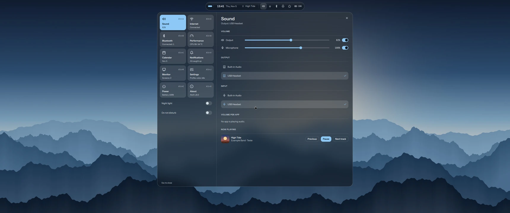

<div align="center">
  
  <h1>Atoll</h1>
  <p><strong>Um shell de desktop completo e de vidro para Hyprland, com tudo a um clique.</strong></p>
  <p><a href="README.md">Read in English</a></p>
</div>



O Atoll troca aquela pilha de barra, lançador, daemon de notificações e apps de configuração por uma interface
única e consistente, feita com [Quickshell](https://quickshell.org). Cada peça flutua sobre o papel de parede, e
as janelas ficam com o resto da tela.

Os prints estão no [README em inglês](README.md#screenshots).

## O que tem

- **Ilha:** áreas de trabalho, relógio, música e status em uma pílula flutuante no topo.
- **Dock:** se esconde na borda inferior, então as janelas ganham a altura toda. Encoste o mouse na borda ou aperte `Super+Z`. A engrenagem escolhe quais apps aparecem: da lista de instalados, ou qualquer programa achado nos seus arquivos.
- **Central:** som, internet, Bluetooth, desempenho, calendário, avisos, ajustes e energia.
- **Cartão de música:** capa, cores tiradas do álbum, barra de tempo, repetir, aleatório, curtidas, volume e troca de saída.
- **Avisos e volume:** cartões de vidro que descem de baixo da ilha.
- **Busca:** aplicativos e telas do sistema no mesmo lugar. Digite "wifi" ou "volume".
- **Idiomas:** English, Português (Brasil), Español, Français, Deutsch, Русский e 简体中文. Segue o idioma do sistema, ou escolha em Ajustes.
- **Tela de bloqueio:** relógio grande, música atual, bateria e sua foto, sobre o seu papel de parede. Ela também recebe você ao voltar da suspensão, sem o desktop piscar antes.
- **Perfis:** cada um guarda nome, foto, idioma, cor, papel de parede, dock e tempos de ociosidade. Crie e troque em Ajustes.
- **Feriados:** de mais de 200 países no calendário, ou nenhum. Escolha em Ajustes.
- **Ociosidade e tela:** tempos separados para tomada e bateria, luz noturna e brilho do monitor.
- **Resistente:** se o shell cair, ele volta sozinho. Suas janelas continuam abertas.

## Requisitos

- **Hyprland com configuração em Lua.** Desenvolvido na 0.56.2. Versões antigas, sem `hl.*`, não funcionam.
- **Quickshell** 0.3 ou mais novo.
- NetworkManager, BlueZ e PipeWire com WirePlumber para as telas correspondentes.
- Fontes Noto (`noto-fonts`, `noto-fonts-cjk`) para exibir russo e chinês.

O Atoll é desenvolvido e testado em uma máquina: Arch Linux com GPU Intel. Outras distribuições e GPUs podem
funcionar, e relatos são bem-vindos.

## Instalar

No Arch Linux:

```sh
git clone https://github.com/brayanspagnol/atoll.git
cd atoll
./install.sh --deps
```

Em outras distribuições, instale os pacotes listados em `install.sh` e rode `./install.sh`.

Saia da sessão e inicie pelo TTY:

```sh
atoll-session
```

Para escolher o Atoll no gerenciador de login, rode também `./install.sh --session`. `--deps` e `--session` pedem
`sudo`; todo o resto fica na sua pasta pessoal. Veja `./install.sh --help`.

> [!WARNING]
> Só um daemon de notificações roda por vez. Se `mako`, `dunst` ou `swaync` estiver instalado, um app pode iniciá-lo
> antes do Atoll, e os avisos não aparecem no shell. Se isso acontecer, desinstale-os.

## Atalhos

| Teclas | Ação |
|---|---|
| `Super+R` | Buscar aplicativos e telas |
| `Super+Z` | Mostrar o dock |
| `Super+N` | Central |
| `Super+Alt+A` / `I` / `B` / `D` | Som / Internet / Bluetooth / Desempenho |
| `Super+Alt+C` / `V` / `J` / `E` | Calendário / Avisos / Ajustes / Energia |
| `Super+Enter` | Terminal |
| `Super+B` / `E` | Navegador / Arquivos |
| `Super+C` | Fechar janela |
| `Super+L` | Bloquear |
| `Super+1…0` | Ir para a área de trabalho |
| `Super+Shift+1…0` | Mover janela para a área de trabalho |
| `Super+Shift+V` | Histórico de cópias |
| `Super+Espaço` | Próximo layout de teclado |
| `Print` / `Shift+Print` | Captura de uma área / da tela inteira |
| `Super+Shift+R` | Reiniciar o shell |

A lista completa está em [`hypr/binds.lua`](hypr/binds.lua).

## Configurar

**Quase tudo** está na tela Ajustes: idioma, cor de destaque, papel de parede, brilho, luz noturna e tempos de ociosidade.
Seus papéis de parede vão em `~/Pictures/Wallpapers`, e a tela de bloqueio segue o que você escolher. A foto é definida por perfil e, sem uma, usa `~/.face`.

**Tela de bloqueio:** é o arquivo `~/.config/atoll/hyprlock.conf`. Atualizações o substituem e guardam sua versão como `hyprlock.conf.bak`.

**Hyprland:** personalizações vão em `~/.config/atoll/user.lua`, que as atualizações nunca alteram. Por exemplo,
teclado ABNT2, um monitor e outro terminal:

```lua
hl.config({ input = { kb_layout = "br,us", kb_variant = "abnt2," } })
hl.monitor({ output = "HDMI-A-1", mode = "3440x1440@60", position = "0x0", scale = 1 })
hl.unbind("SUPER + Return") -- sem isso, os dois comandos rodam
hl.bind("SUPER + Return", hl.dsp.exec_cmd("foot"))
```

**Shell:** as opções ficam em `~/.config/atoll/profiles/<perfil>.json`, um arquivo por perfil, aplicado ao salvar:

| Chave | Significado |
|---|---|
| `dock` | Apps fixados, normalmente editados pela engrenagem do dock. Cada um tem `label`, `ids` (app ids do Wayland em minúsculas), um ícone (`icon`, chave de [`Icons.qml`](shell/Icons.qml), ou `appIcon`, nome no tema de ícones) e o que iniciar (`desktopId` ou `cmd`) |
| `language` | `auto`, ou um código de idioma como `en`, `pt-BR`, `es`, `fr`, `de`, `ru` ou `zh-CN` |
| `holidays` | Código de país como `BR` ou `DE`, `off`, ou `auto` para o país do idioma do sistema |
| `name`, `photo` | Nome e foto do perfil |
| `accent` | `gelo`, `areia`, `hortela` ou `coral` |
| `wallpaper` | Caminho da imagem, ou vazio para cor sólida |

## Atualizar e remover

```sh
git pull && ./install.sh   # atualiza; ajustes, eventos e curtidas ficam
./uninstall.sh             # remove; com --purge apaga seus dados também
```

## Limites conhecidos

- **Aleatório e repetir dependem do player.** Navegadores não os expõem via MPRIS. O Atoll emula repetir a música
  voltando ao início 1,5 s antes do fim, e o aleatório fica indisponível nesses casos.
- **Curtidas são locais.** Não chegam ao Spotify nem ao YouTube Music, porque o MPRIS não tem esse conceito.
- **Eventos do calendário são locais.** Não há sincronização com Google Agenda ou CalDAV.
- **Feriados são só nacionais,** com nome em inglês ou no idioma do país, e precisam de conexão na primeira vez.
- **Eventos e curtidas são compartilhados** entre os perfis.
- **Parear Bluetooth** funciona com aparelhos que não pedem código. Para teclados que mostram um, use `bluetoothctl`.
- **Blur** usa a GPU. Se ficar lento, desligue em `user.lua`:
  `hl.config({ decoration = { blur = { enabled = false } } })`.

## Privacidade

O Atoll não pede conta nem envia telemetria. Só um recurso usa a rede: ao abrir o calendário ou os Ajustes, ele baixa feriados de
[date.nager.at](https://date.nager.at), que vê seu IP, o país e os anos pedidos. O resultado fica em `~/.cache/atoll/holidays`.
Para desligar, deixe `holidays` em `off`.

## Problemas comuns

- **O shell não aparece:** leia `~/.local/state/atoll/shell.log`. Aperte `Super+Shift+R` para reiniciar.
- **Sem avisos:** veja o aviso em [Instalar](#instalar).
- **Ícones faltando:** confira se `papirus-icon-theme` está instalado.

## Contribuir

Relatos de bugs, correções de tradução e pull requests são bem-vindos: leia [CONTRIBUTING.md](CONTRIBUTING.md) e o
[Código de Conduta](CODE_OF_CONDUCT.md). Para problemas de segurança, veja [SECURITY.md](SECURITY.md). As versões
seguem [Versionamento Semântico](https://semver.org), e as mudanças ficam no [changelog](CHANGELOG.md).

## Licença

[MIT](LICENSE) © 2026 Brayan Spagnol. Créditos de terceiros em [THIRD_PARTY_NOTICES.md](THIRD_PARTY_NOTICES.md).
